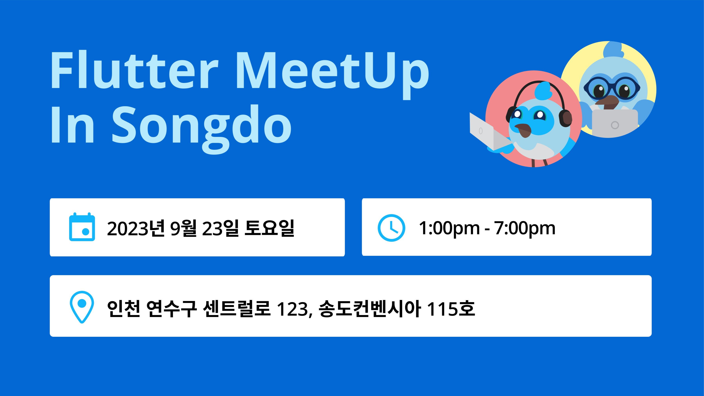

# Flutter Songdo Archive



> 인천 송도 기반 Flutter 개발자 지역 커뮤니티 **Flutter Songdo** (2022–2025)의 활동 기록입니다.
> Meetup 그룹 폐쇄(2026년 11월)에 앞서 이벤트와 사진을 이곳에 보관합니다.

Flutter Songdo는 인천 송도에 거주하는 Flutter 개발자들의 지역 커뮤니티입니다. 다양한 기술 주제에 대한 온라인 및 대면 이벤트를 주최했습니다.

Flutter Songdo is a local community of Flutter developers based in Songdo, Incheon, KR. An online and in-person tech-enthusiast group hosting events on a range of tech topics.

## 한눈에 보기

| 항목 | 내용 |
|---|---|
| 활동 기간 | 2022.12 – 2025.03 |
| 지역 | 인천 송도 (오프라인 + 온라인) |
| Meetup 회원 | 208명 |
| 이벤트 | 13회 (오프라인 11 · 온라인 2) |
| Meetup RSVP 합계 | 122명 (별도 신청폼·현장 참여자 제외) |
| 소속 | [Flutter Meetup Network](https://www.meetup.com/pro/flutter/) |
| 협력 | GDG Songdo / GDG Incheon, 송도Dev, CJ 올리브네트웍스 K-Digital Platform, 인천스타트업파크 |

## 주요 활동

- **Code in Songdo (2022, 2023, 2024)**: 아이디어 발표 → 팀 빌딩 → 멘토와 함께 7~9주간 Flutter 앱 서비스 제작 → 시연. 2024년에는 Cursor AI를 결합해 4주 만에 서비스 런칭에 도전했습니다.
- **Flutter MeetUp In Songdo (2023.09)**: GDG Songdo와 함께 송도 컨벤시아에서 중상급 개발자 대상 8개 세션 밋업을 열었습니다.
- **스터디**: 플러터 기초부터 클린 아키텍처까지 3주 과정(2024.07), 플러터 개발 가속 방법 온라인 코드랩(2024.04).
- **Flutter Forward 뷰잉파티 (2023.01)**: Gather에서 39명이 함께 시청했습니다.
- **네트워킹**: 송도 치맥 파티(2023, 2024), 서비스 런칭 회고 애프터 파티(2025).

## 이벤트 타임라인

| 날짜 | 이벤트 | 형태 | 방식 | RSVP |
|---|---|---|---|---|
| 2025-03-22 | [[Flutter In Production Extended Songdo] After Party](events/2025-03-22-flutter-in-production-after-party.md) | 네트워킹 / 회고 | 오프라인 | 2 |
| 2024-12-21 | [Flutter In Production Extended Songdo](events/2024-12-21-flutter-in-production-extended-songdo.md) | 밋업 | 오프라인 | 1 |
| 2024-12-21 | [24 Flutter Extended Meetup with Code in Songdo](events/2024-12-21-flutter-extended-code-in-songdo-2024.md) | 해커톤/프로젝트 (AI) | 오프라인 | 5 |
| 2024-09-28 | [Flutter Songdo 맥주파티](events/2024-09-28-beer-party-2024.md) | 네트워킹 (송도Dev 공동) | 오프라인 | 3 |
| 2024-07-27 | [Flutter Study In Songdo - 플러터 기초부터 클린아키텍처까지 (3주차)](events/2024-07-27-flutter-study-week3.md) | 스터디 | 오프라인 | 5 |
| 2024-07-20 | [Flutter Study In Songdo - 플러터 기초부터 클린아키텍처까지 (2주차)](events/2024-07-20-flutter-study-week2.md) | 스터디 | 오프라인 | 4 |
| 2024-07-13 | [Flutter Study In Songdo - 플러터 기초부터 클린아키텍처까지 (1주차)](events/2024-07-13-flutter-study-week1.md) | 스터디 | 오프라인 | 10 |
| 2024-04-20 | [플러터 개발 가속 방법 스터디 (with 인스타앱 같이 만들어보기)](events/2024-04-20-flutter-dev-acceleration-study.md) | 스터디/코드랩 | 온라인 | 24 |
| 2023-12-16 | [[Flutter] Code in Songdo 2023](events/2023-12-16-code-in-songdo-2023.md) | 해커톤/프로젝트 | 오프라인 | 10 |
| 2023-09-23 | [Flutter MeetUp In Songdo](events/2023-09-23-flutter-meetup-in-songdo.md) | 컨퍼런스 (GDG Songdo 공동) | 오프라인 | 13 |
| 2023-05-27 | [Flutter in Songdo 맥주파티!](events/2023-05-27-beer-party-2023.md) | 네트워킹 | 오프라인 | 3 |
| 2023-01-25 | [Flutter Forward Online Viewing Party Songdo](events/2023-01-25-flutter-forward-viewing-party.md) | 뷰잉파티 | 온라인 | 39 |
| 2022-12-17 | [[Flutter] Code in Songdo](events/2022-12-17-code-in-songdo-2022.md) | 해커톤/프로젝트 | 오프라인 | 3 |

## 저장소 구조

```
events/     이벤트별 상세 (마크다운)
images/     이벤트 커버와 사진 (scripts/download_images.sh로 수집)
data/       원본 데이터 (events.json)
```

## 오거나이저

양수장 외 공동 오거나이저 2명

---

이 기록은 개인정보(회원 명단, 연락처)를 제외하고 공개된 이벤트 정보만 담고 있습니다.
