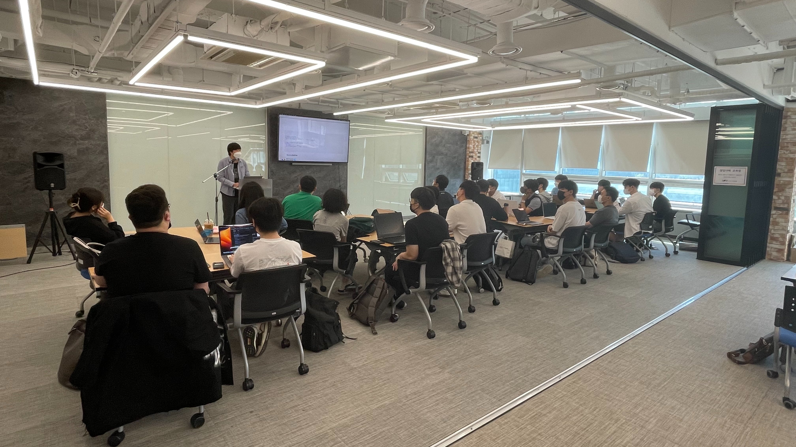
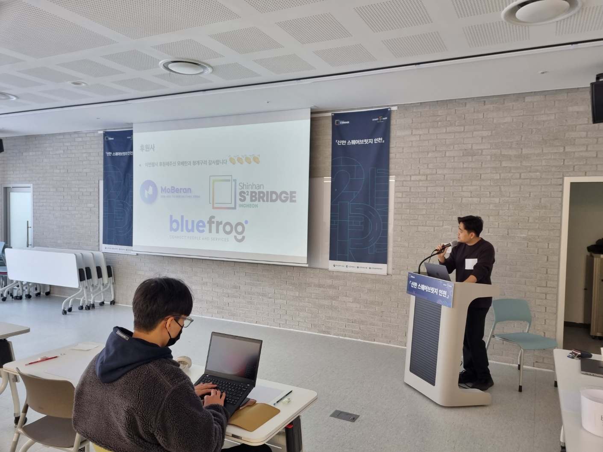
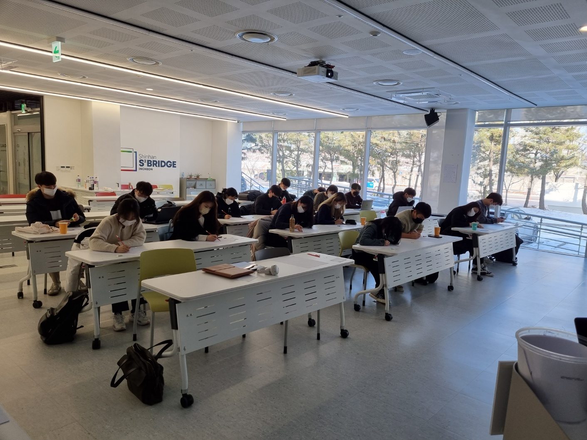
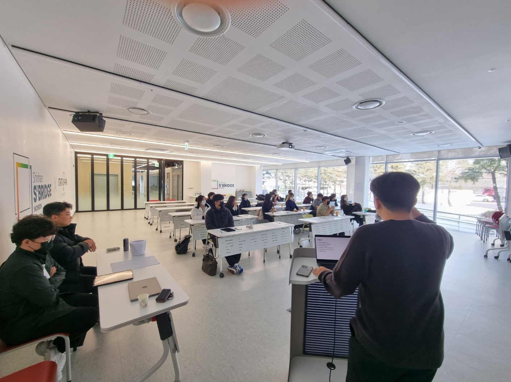

# [Flutter] Code in Songdo

| 항목 | 내용 |
|---|---|
| 날짜 | 2022-12-17 13:00 (KST) |
| 형태 | 해커톤/프로젝트 · 오프라인 |
| 장소 | 인천스타트업파크 인스타2관 신한스퀘어브릿지 인천 (인천 연수구 컨벤시아대로 204) |
| Meetup 참석자 | 3명 (RSVP 기준) |
| 원본 | https://www.meetup.com/flutter-songdo/events/289679406/ (그룹 폐쇄 후 접근 불가) |

4개의 아이디어, 4명의 멘토들과 함께 4개의 팀을 이뤄 Flutter로 앱 서비스를 만드는 7주 과정입니다. 아이디어 발표 및 팀 빌딩 시간에 참가자 전원이 아이디어를 발표합니다.

## 일정

- 아이디어 발표 및 팀 빌딩: 2022년 12월 17일
- 팀간 진행상황 발표: 2023년 1월 7일
- 발표 및 시연, 뒷풀이: 2023년 1월 28일
- 1차 모집기간: 2022년 10월 29일 → 11월 5일
- 2차 모집기간: 2022년 11월 28일 → 12월 9일
- 행사 기간: 2022년 12월 17일 → 2023년 1월 28일 (총 7주)

## 장소 및 시간

인천 연수구 컨벤시아대로 204, 인천스타트업파크 인스타2관 신한스퀘어브릿지 인천 1층 브릿지1 (강의실), 토요일 오후 1시 ~ 3시

## 우대조건

- [Flutter] Study in Songdo 참가자
- 인천, 송도 거주자
- 참여 각오를 자세히 적어주신 분
- 아이디어가 선정되지 않아도 성실히 참여할 수 있는 사람

## 사진

