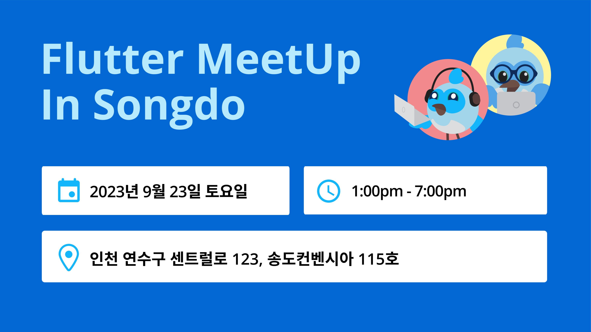

# Flutter MeetUp In Songdo

| 항목 | 내용 |
|---|---|
| 날짜 | 2023-09-23 13:00 (KST) |
| 형태 | 컨퍼런스 (GDG Songdo 공동) · 오프라인 |
| 장소 | 송도 컨벤시아 115호 |
| Meetup 참석자 | 13명 (RSVP 기준) |
| 원본 | https://www.meetup.com/flutter-songdo/events/296073288/ (그룹 폐쇄 후 접근 불가) |

GDG Songdo와 함께한, 플러터 **중상급 사용자**를 위한 8개 세션 밋업입니다. 송도 컨벤시아 115호에서 80명 선착순으로 진행했습니다.

## Time table

| 시간 | 세션 | 발표자 |
|---|---|---|
| 13:00 - 13:05 | Registration | |
| 13:05 - 13:15 | Keynote | 김석용 (GDG Songdo Organizer) |
| 13:15 - 13:45 | What's New Flutter | 정혜진 |
| 13:45 - 14:15 | 다트, 어떻게 쓰면 좋을까? with Dart 3.0 | 김승빈 |
| 14:15 - 14:45 | 심사를 피하는 양날의 부리, ShoreBird | 유병욱 |
| 14:50 - 15:20 | **상태관리 올바르게 쓰기** | **양수장** |
| 15:20 - 15:50 | Custom Painter Canvas | 박제창 |
| 15:55 - 16:25 | Flutter with AI TensorFlow Lite | 우성우 |
| 16:25 - 16:55 | 로컬디비 다루는 노하우, in Flutter | 이준규 |
| 17:00 - 17:30 | 플러터에 Apple Pay, Google Pay를 붙여보자 | 조새벽 |
| 17:30 - 18:00 | 플러터로 설명하는 WebSite와 WebApp의 차이 | 송승현 |

## Code of Conduct

사람을 존중하고, 친절하게 대하고, 다른 사람의 이야기를 잘 들어주세요.

> GDG Korea는 Google과 독립적인 단체로, 활동과 발표 내용은 Google과 관련이 없습니다.
