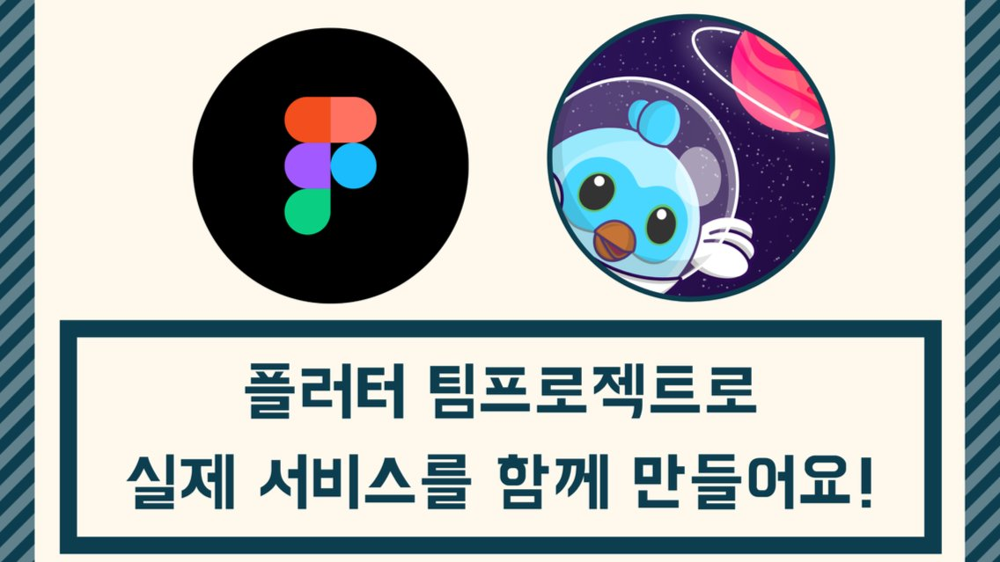

# [Flutter] Code in Songdo 2023

| 항목 | 내용 |
|---|---|
| 날짜 | 2023-12-16 13:00 (KST) |
| 형태 | 해커톤/프로젝트 · 오프라인 |
| 장소 | 송도 CJ K-Digital Platform |
| Meetup 참석자 | 10명 (RSVP 기준) |
| 원본 | https://www.meetup.com/flutter-songdo/events/296575492/ (그룹 폐쇄 후 접근 불가) |

4개의 아이디어, 4명의 멘토들과 함께 4개의 팀을 이뤄 Flutter로 앱 서비스를 만드는 9주 과정입니다.

## 일정

- 아이디어 발표 및 팀 빌딩: 2023년 12월 16일
- 팀간 진행상황 발표: 2024년 1월 13일
- 발표 및 시연, 뒷풀이: 2024년 2월 17일
- 1차 모집기간: 2023년 11월 8일 → 11월 25일
- 2차 모집기간: 2023년 12월 2일 → 12월 9일

## 장소 및 시간

2023년 12월 16일 토요일 13시 ~ 17시, 송도 CJ K-Digital Platform (O.T / 아이디어 발표 및 팀 빌딩)

## 우대조건

- 인천, 송도 거주자
- 참여 각오를 자세히 적어주신 분
- 아이디어가 선정되지 않아도 성실히 참여할 수 있는 사람

행사 안내: http://codein.gdgincheon.com
