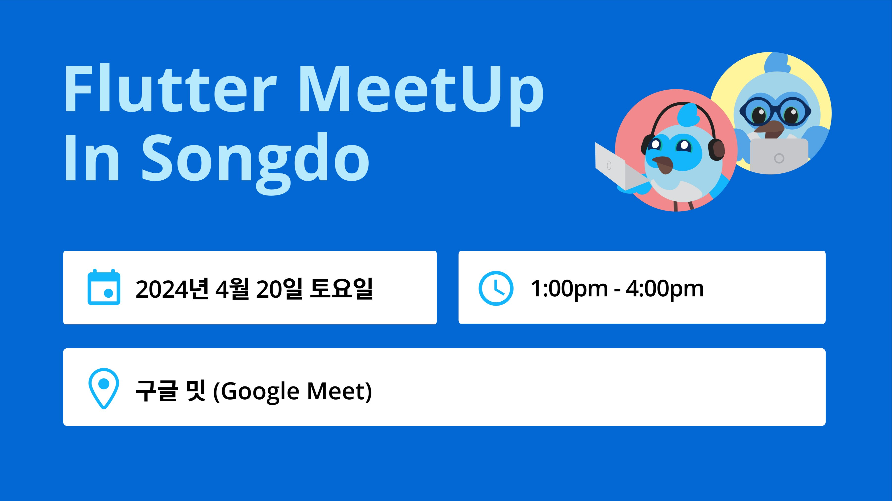

# 플러터 개발 가속 방법 스터디 (with 인스타앱 같이 만들어보기)

| 항목 | 내용 |
|---|---|
| 날짜 | 2024-04-20 13:00 (KST) |
| 형태 | 스터디/코드랩 · 온라인 |
| 장소 | 온라인 (Google Meet) |
| Meetup 참석자 | 24명 (RSVP 기준) |
| 원본 | https://www.meetup.com/flutter-songdo/events/300370359/ (그룹 폐쇄 후 접근 불가) |

## 행사 개요

- 행사 일시: 4월 20일(토) 1시~4시 (필요할 경우 QnA 시간 연장)
- 행사 플랫폼: Google Meet (온라인)
- 참가 대상: 플러터 초중급 이상 개발자

## 주요 내용

플러터를 0번대 버전부터 다뤄오며 오랫동안 고민해 온 플러터 개발 방향에 대한 성과를 공유하고, 같이 다양한 페이지를 만들어 보는 스터디(밋업 + 코드랩)입니다.

- 인스타, 날씨앱, 넷플릭스 등의 페이지를 다루며, 인스타앱은 같이 만들어 봅니다.
- 온라인에서 무료로 진행하고, 강의와 과제로 이루어져 있습니다.
- 3개의 파트(프론트, 백, 배포)로 이루어진 방법론(juneflow) 중 첫 번째 파트에 대한 스터디입니다.
- 각 파트의 과제를 완수한 경우 다음 파트 스터디에 참여할 수 있습니다.

## 사진

