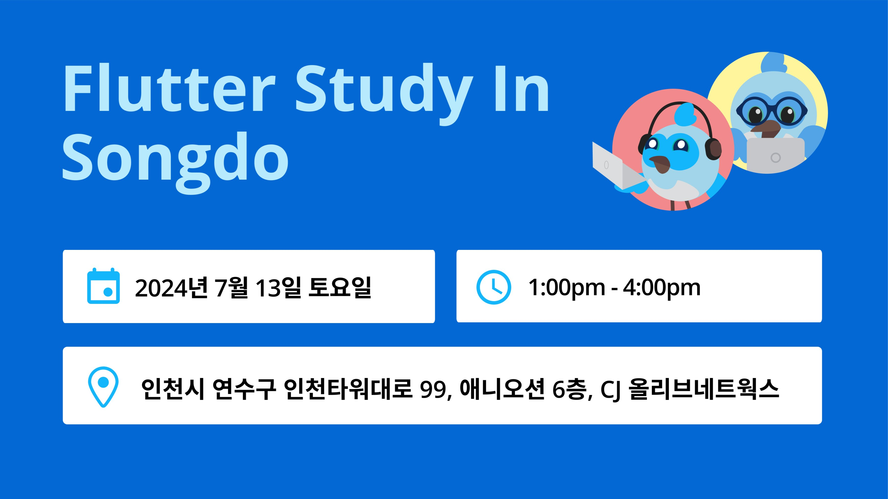
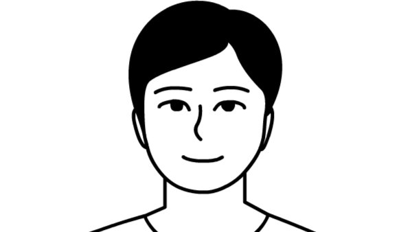
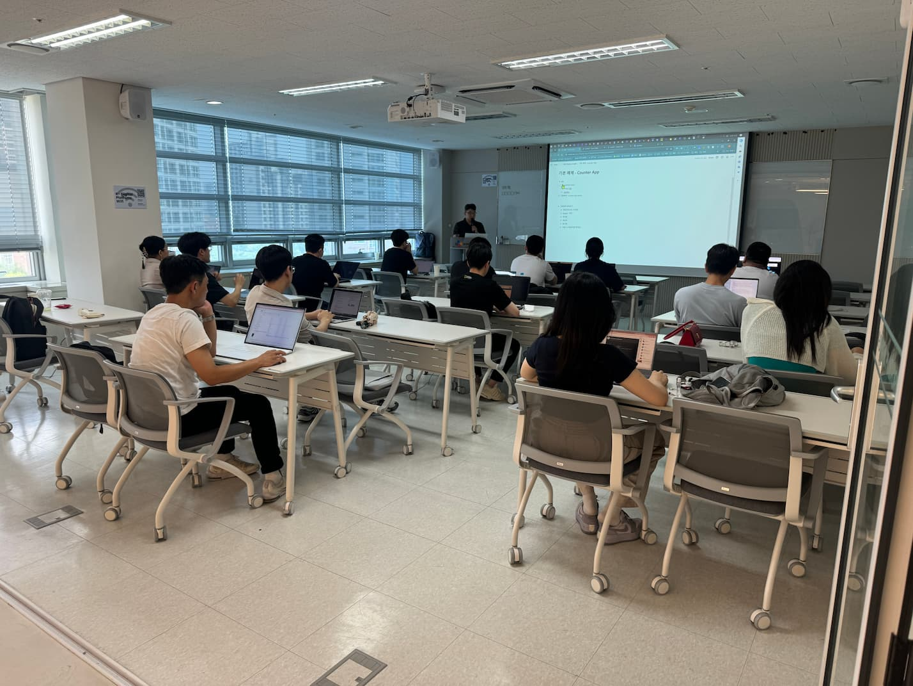

# Flutter Study In Songdo - 플러터 기초부터 클린아키텍처까지 (1주차)

| 항목 | 내용 |
|---|---|
| 날짜 | 2024-07-13 13:00 (KST) |
| 형태 | 스터디 · 오프라인 |
| 장소 | CJ 올리브네트웍스, 애니오션빌딩 6층 (인천 연수구 인천타워대로 99) |
| Meetup 참석자 | 10명 (RSVP 기준) |
| 원본 | https://www.meetup.com/flutter-songdo/events/301505648/ (그룹 폐쇄 후 접근 불가) |

## 행사 개요

- 모집 대상: 플러터에 관심을 가지고 있는 학생, 직장인 누구나
- 모집 인원: 15명
- 행사 일시: 7월 13일 ~ 7월 27일 매주 토요일 오후 1시부터 4시 (3주 과정)

## 행사 주요 내용

Flutter와 Dart에 대한 기초 지식을 쌓고, 클린 아키텍처 이론까지 배우는 세션입니다. 3주간의 강의를 통해 다음 내용을 학습합니다.

- Flutter의 기초 내용부터 시작하여 다양한 위젯과 레이아웃
- 화면 이동과 상태 관리, 비동기 개념
- 예제 코드와 함께 실제 프로젝트에 사용할 수 있는 클린 아키텍처

## 참가 안내

- 참가 신청: 구글 신청서 양식 제출 후 선발
- 참가비: 없음
- 모집 인원 초과 시 선발하여 스터디 인원 구성

## 장소

인천광역시 연수구 인천타워대로 99, 애니오션빌딩 6층, CJ 올리브네트웍스 (지식정보단지역 2번 출구에서 409m)

## 사진

