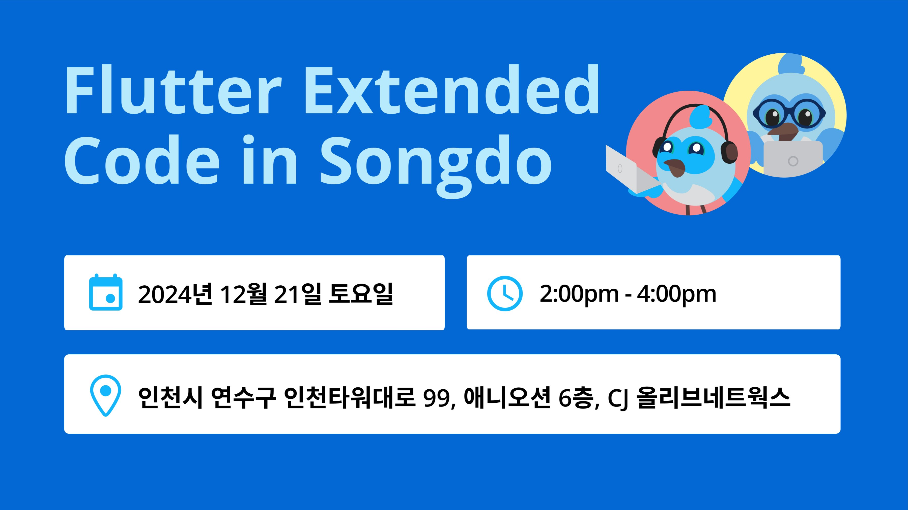
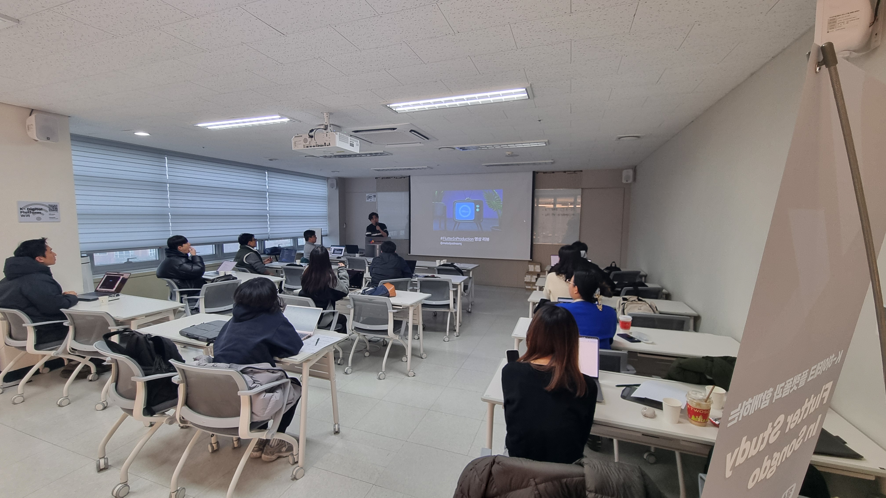
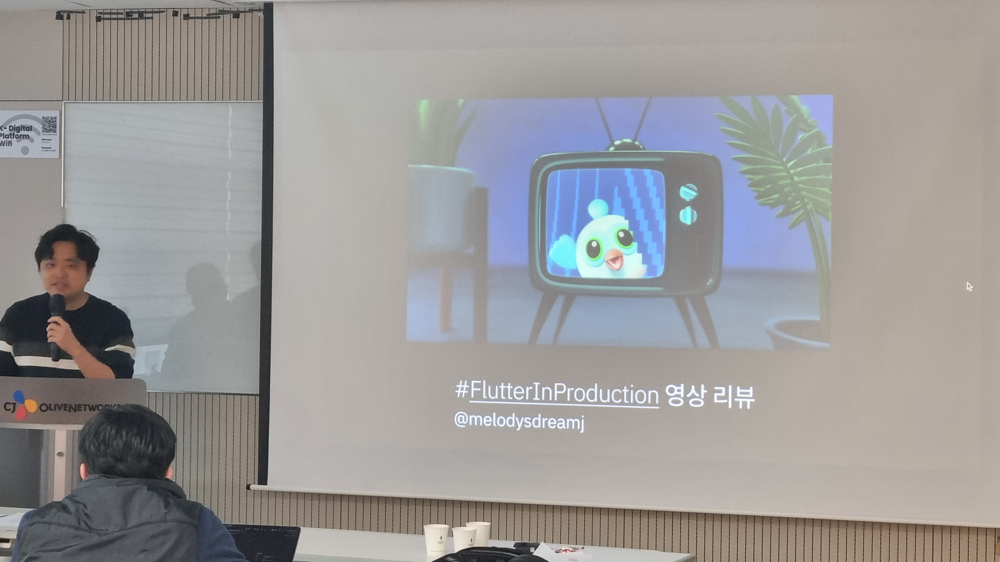
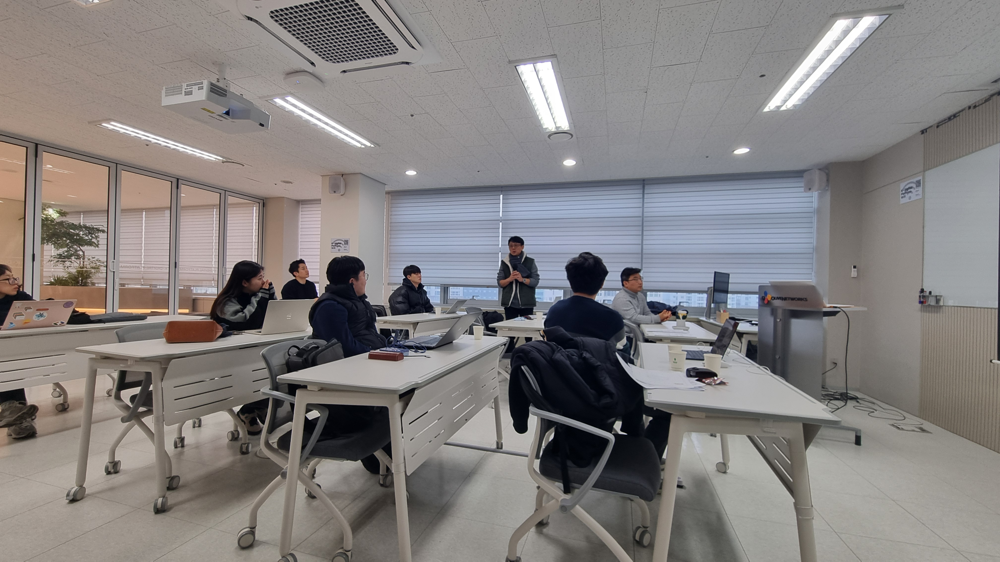

# 24 Flutter Extended Meetup with Code in Songdo

| 항목 | 내용 |
|---|---|
| 날짜 | 2024-12-21 14:00 (KST) |
| 형태 | 해커톤/프로젝트 (AI) · 오프라인 |
| 장소 | CJ 올리브네트웍스, 애니오션빌딩 6층 (인천 연수구 인천타워대로 99) |
| Meetup 참석자 | 5명 (RSVP 기준) |
| 원본 | https://www.meetup.com/flutter-songdo/events/304375559/ (그룹 폐쇄 후 접근 불가) |

Flutter의 최신 기술과 AI를 결합한 4주 프로젝트 과정입니다. 호스트들이 준비한 최신 Flutter 내용과 생성형 AI 툴 Cursor AI를 활용해 각자의 앱이나 웹 서비스를 만듭니다. 모든 참가자가 자신의 아이디어를 실제 서비스로 라이브하는 것을 목표로 하며, 현직 개발자 멘토들이 완성을 도왔습니다.

## 개요

- 모집 대상: 플러터와 개발에 관심 있는 사람 (디자이너, 기획자 환영, 비전공자 가능)
- 모집 인원: 15명
- 일시: 12월 21일 ~ 1월 18일 토요일 오후 2시 ~ 4시
- 첫 모임: 2024년 12월 21일 송도 CJ K-Digital Platform (O.T / 아이디어 발표 및 팀 빌딩)
- 참가비: 없음 (Cursor 사용료 20달러는 개인 부담)

## 사진

